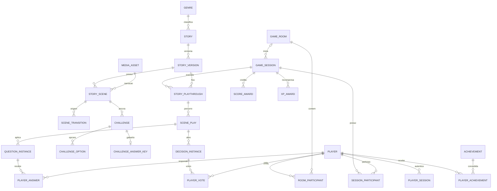

# English Roulette — DATABASE.md

> **Versão:** 1.0 — proposta para validação  
> **Data:** 06/11/2026  
> **Status:** especificação técnica; ainda não corresponde a migrations executadas  
> **Referências:** `REQUIREMENTS.md` v1.3, `ARCHITECTURE.md`, `CODING_STANDARDS.md`, `GAME_RULES.md`  
> **Banco exclusivo:** PostgreSQL | **ORM:** Entity Framework Core + Npgsql

## 1. Propósito e princípios

Este documento define o **modelo lógico inicial**, chaves, relacionamentos, restrições, índices, cuidados de versionamento e sequência de migrations. A implementação pode refinar nomes e detalhes, mas qualquer mudança na integridade das regras deve ser refletida aqui.

Princípios obrigatórios:

1. **Um único banco PostgreSQL** para catálogo, identidade, sessões, progresso e histórico. Separação em módulos de código, não em microserviços.
2. **Mídias fora do banco**: MP3/Opus, imagens e efeitos ficam inicialmente em volume persistente na VPS; o banco armazena chave de armazenamento e metadados.
3. **Histórias publicadas são imutáveis**: um ajuste no texto, áudio, pergunta ou caminho cria uma nova `StoryVersion`.
4. **Uma sessão registra a versão específica** que foi jogada; partidas antigas não mudam ao editar o catálogo.
5. **O servidor é autoritativo** para sorteios, fase, prazos, avaliação, votos e pontos. O cliente nunca envia pontos como dados confiáveis.
6. **Integridade no banco e no domínio**: constraints impedem duplicatas, serviços verificam regras que dependem de contagem, estado e percurso.
7. **Single Player e Multiplayer reaproveitam o mesmo catálogo e o mesmo motor de história**; divergem em políticas de tempo, decisões e pontuação.
8. **Sem exclusão em cascata de histórico**; arquivar/desativar conteúdo em vez de destruir conteúdo referenciado.

### Convenções de banco e C#

| Aspecto | Convenção |
|---|---|
| Nome físico | `snake_case`, plural para tabelas; EF Core mapeia classes `PascalCase` |
| Chave primária | `id uuid` (`Guid` em C#), gerada pela aplicação ou provedor com estratégia uniforme |
| FKs | `<referencia>_id`; índices explícitos quando usados em consultas |
| Horários | `timestamptz` em UTC; usar `DateTimeOffset` UTC ou `DateTime` UTC de forma consistente |
| Durações | Inteiros em milissegundos para mídias; segundos inteiros em configurações de jogo |
| Texto | `text` ou `varchar(n)` com limites de negócio documentados |
| Status e modos | enums no domínio; armazenar como `varchar` com valores validados (ou enum PostgreSQL se houver decisão posterior) |
| Configurações congeladas | `jsonb` para snapshot **versionado** de regras/configurações, não para substituir relacionamentos |
| Concorrência | `state_version bigint` + comparação atômica nas sessões; índices únicos para comandos repetidos |
| Datas de auditoria | `created_at_utc`, `updated_at_utc`, quando aplicável |
| Exclusão | `RESTRICT`/`NO ACTION` por padrão para dados históricos e publicações |

**Valores textuais controlados**: impor `CHECK` nos códigos mais estáveis quando útil; validar sempre no domínio. Em EF Core, mapear valores explicitamente para evitar mudanças silenciosas ao renomear enums.

## 2. Modelo de domínio e cardinalidades



**Observação:** o diagrama mostra somente os vínculos principais. `SceneTransition.target_scene_id` também aponta para `StoryScene`; `MediaAsset` pode servir para capa, ilustração, áudio ou efeitos. As relações exatas e restrições aparecem nas seções seguintes.

## 3. Catálogo e mídia

### 3.1 `genres`

| Coluna | Tipo | Regra |
|---|---|---|
| `id` | uuid | PK |
| `slug` | varchar(80) | UNIQUE, imutável |
| `name` | varchar(120) | obrigatório |
| `icon_key` | varchar(80) | opcional |
| `color_hex` | char(7) | opcional; validar formato |
| `is_active` | boolean | default true |
| `created_at_utc` | timestamptz | obrigatório |

### 3.2 `stories`

Identidade editorial estável, independente das versões.

| Coluna | Tipo | Regra |
|---|---|---|
| `id` | uuid | PK |
| `genre_id` | uuid | FK → `genres` |
| `slug` | varchar(160) | UNIQUE |
| `internal_title` | varchar(200) | nome de trabalho |
| `is_discoverable` | boolean | se pode aparecer no catálogo/roleta |
| `created_at_utc`, `updated_at_utc` | timestamptz | auditoria |

Um `Story` poderá ter versões para níveis diferentes; o título exibido ao usuário pertence à versão publicada.

### 3.3 `story_versions`

| Coluna | Tipo | Regra |
|---|---|---|
| `id` | uuid | PK |
| `story_id` | uuid | FK → `stories` |
| `version_number` | integer | > 0; UNIQUE (`story_id`, `version_number`) |
| `difficulty` | varchar(8) | `A1`, `A2`, `B1`; estrutura preparada para `B2`, `C1` |
| `language` | varchar(10) | default `en` |
| `title`, `synopsis` | text | obrigatórios antes de publicar |
| `estimated_minutes` | smallint | > 0 |
| `status` | varchar(20) | `DRAFT`, `IN_REVIEW`, `PUBLISHED`, `ARCHIVED` |
| `cover_asset_id` | uuid nullable | FK → `media_assets` |
| `source_title`, `source_author`, `source_url` | text nullable | procedência |
| `license_type`, `license_evidence` | text | obrigatórios ao publicar |
| `adaptation_notes`, `attribution_text` | text nullable | revisão e créditos |
| `reviewed_by_admin_id` | uuid nullable | FK → `admin_users` |
| `published_at_utc` | timestamptz nullable | preenchido na publicação |
| `created_at_utc`, `updated_at_utc` | timestamptz | auditoria |

- **Regra editorial:** somente uma versão publicada por par (`story_id`, `difficulty`, `language`) pode ficar selecionável na roleta; versões anteriores podem passar a `ARCHIVED`, mas continuam disponíveis para histórico.
- Criar índice único parcial para versão selecionável publicada; documentar na migration.
- **Após `PUBLISHED`, os dados usados pelo jogo não são alterados em lugar**. Criar nova versão (`DUPLICATE AS DRAFT`) e publicar posteriormente.
- Não apagar fisicamente versões que apareçam em `story_playthroughs`.

### 3.4 `story_scenes`

| Coluna | Tipo | Regra |
|---|---|---|
| `id` | uuid | PK |
| `story_version_id` | uuid | FK → `story_versions` |
| `scene_key` | varchar(80) | estável dentro da versão; UNIQUE (`story_version_id`, `scene_key`) |
| `title` | varchar(200) | obrigatório |
| `narration_text` | text | obrigatório |
| `scene_kind` | varchar(12) | `START`, `NORMAL`, `ENDING` |
| `audio_asset_id` | uuid nullable | FK → `media_assets`; obrigatório ao publicar |
| `image_asset_id` | uuid nullable | FK → `media_assets` |
| `audio_duration_ms` | integer nullable | > 0 quando preenchido; obrigatório ao publicar |
| `editorial_order` | integer | ordem de editor, não define sozinha a narrativa |
| `created_at_utc` | timestamptz | obrigatório |

Regras ao publicar uma versão:
- Exatamente **uma cena inicial** (`START`) e pelo menos uma final (`ENDING`).
- Todas as cenas/arestas publicadas devem pertencer **à mesma `story_version_id`**; validar no serviço de publicação e, preferencialmente, com FKs compostas.
- Grafo **sem ciclos na V1** para evitar histórias infinitas.
- Todos os caminhos alcançáveis a partir da inicial devem conseguir chegar a um final; cenas órfãs são bloqueadas na publicação.
- Cena final não possui transições de saída; cena que oferece escolhas precisa ter transições válidas.

### 3.5 `scene_transitions`

| Coluna | Tipo | Regra |
|---|---|---|
| `id` | uuid | PK |
| `story_version_id` | uuid | FK → `story_versions`; igual nas duas cenas |
| `source_scene_id` | uuid | FK → cena de origem |
| `target_scene_id` | uuid | FK → cena de destino |
| `option_text` | varchar(300) | escolha exibida ao jogador |
| `display_order` | smallint | ordem por cena |
| `is_default` | boolean | política de fallback configurável |

Índices/constraints: UNIQUE (`source_scene_id`, `display_order`), CHECK (`source_scene_id <> target_scene_id`), e índice único parcial para `is_default = true` por cena. O serviço de publicação verifica que ambas as cenas pertencem à mesma versão e que não há loops.

### 3.6 `media_assets`

| Coluna | Tipo | Regra |
|---|---|---|
| `id` | uuid | PK |
| `kind` | varchar(16) | `AUDIO`, `IMAGE`, `SOUND_EFFECT` |
| `visibility` | varchar(16) | `PRIVATE_DRAFT`, `PUBLIC` |
| `storage_provider` | varchar(20) | inicialmente `LOCAL` |
| `storage_key` | text | chave relativa imutável; UNIQUE (`storage_provider`, `storage_key`) |
| `original_filename` | varchar(255) | apenas metadado, nunca caminho físico |
| `content_type` | varchar(100) | validado |
| `size_bytes` | bigint | > 0 |
| `sha256_hex` | char(64) | integridade |
| `duration_ms` | integer nullable | áudio |
| `width_px`, `height_px` | integer nullable | imagem |
| `license_type`, `attribution_text` | text nullable | direitos autorais |
| `created_at_utc`, `published_at_utc` | timestamptz | timestamps |

**Não armazenar** MP3, imagens em base64 ou URL completa no PostgreSQL. Exemplo de storage key: `audio/2026/11/<uuid>.mp3`. **Não sobrescrever** um arquivo publicado; uma atualização cria outro `MediaAsset`.

### 3.7 Entrega de mídia e licenciamento

- VPS V1: mídia publicada em volume montado no serviço de arquivos, mídia de rascunho em área **não publicada**.
- `StoryScene.audio_asset_id` aponta para o áudio correspondente àquela versão.
- `MediaAsset` é reutilizável por múltiplas cenas **se for o mesmo conteúdo e possuir a mesma autorização**.
- Excluir arquivo somente após verificar ausência de referências no catálogo e no histórico, respeitando retenção; preferir limpeza controlada e auditável.
- Migrar para object storage S3-compatível futuramente mudando implementação de `IMediaStorage`, mantendo o contrato de `storage_key`.
- Validar uso, adaptação e distribuição de textos, traduções, áudios, capas e efeitos antes da publicação.

## 4. Banco de perguntas e minijogos

### 4.1 `challenges`

| Coluna | Tipo | Regra |
|---|---|---|
| `id` | uuid | PK |
| `story_version_id` | uuid | FK → `story_versions` |
| `anchor_scene_id` | uuid | cena após a qual é elegível; FK da mesma versão |
| `type` | varchar(32) | `MULTIPLE_CHOICE`, `TRUE_FALSE`, `MISSING_WORD`, `SEQUENCE_ORDER`, `SCRAMBLED_SENTENCE`, `WHO_SAID_IT`, `MEMORY_RECALL`, `FIND_THE_LIE` |
| `difficulty` | varchar(8) | nível da questão |
| `prompt` | text | enunciado |
| `explanation` | text | exibida só depois da fase correta |
| `skill` | varchar(20) | `LISTENING`, `READING`, `VOCABULARY`, `MEMORY`, `INFERENCE`, `GRAMMAR` |
| `base_points` | integer | configura valor de referência; não define ranking multiplayer sozinho |
| `time_limit_seconds` | integer | limite positivo |
| `weight` | integer | peso de sorteio, >= 1 |
| `is_required`, `is_active` | boolean | obrigatório/variante e publicação |
| `editorial_group_key` | varchar(80) nullable | agrupa variantes da mesma habilidade/cena |

- A questão pertence a uma versão imutável, **mesmo quando é sobre cena anterior**.
- Exigir na publicação uma quantidade de questões suficiente para cada caminho possível, nível e evento ativado.
- `SPEED_ROUND` é **evento que agenda várias questões**, e não um tipo independente persistido em `challenges`.

### 4.2 `challenge_options`

| Coluna | Tipo | Regra |
|---|---|---|
| `id` | uuid | PK |
| `challenge_id` | uuid | FK → `challenges` |
| `label` | text | texto da alternativa/token |
| `display_order` | smallint | posição editorial |
| `token_key` | varchar(80) nullable | identidade para exercícios de ordenação |

UNIQUE (`challenge_id`, `display_order`). O conjunto de alternativas e tokens é validado por tipo na publicação.

### 4.3 `challenge_answer_keys`

| Coluna | Tipo | Regra |
|---|---|---|
| `challenge_id` | uuid | PK e FK → `challenges` |
| `answer_json` | jsonb | objeto tipado pelo tipo de desafio |
| `schema_version` | smallint | para evolução do formato |

Exemplos de gabaritos: `{ "optionId": "..." }` para múltipla escolha; `{ "orderedTokenKeys": ["a", "b", "c"] }` para reordenação. Para evitar ambiguidade, **não usar `is_correct` em `challenge_options`**; o gabarito reside somente nesta tabela. `ChallengeEvaluator` valida o `answer_json` antes de publicar e na avaliação.

**Segurança:** `challenge_answer_keys` nunca deve ser serializada para contratos da interface durante uma pergunta aberta. Proteger tanto os endpoints HTTP quanto os eventos SignalR.

### 4.4 `challenge_scene_requirements` *(recomendado para memória/retrospectiva)*

| Coluna | Tipo | Regra |
|---|---|---|
| `challenge_id` | uuid | FK → `challenges` |
| `required_scene_id` | uuid | FK → `story_scenes`; mesma versão |

PK (`challenge_id`, `required_scene_id`). Uma pergunta só é elegível quando todas as cenas requeridas foram realmente visitadas. Isso impede spoiler de caminhos não percorridos.

## 5. Identidade, administração e lobby

### 5.1 `players`

`id uuid PK`; `nickname varchar(40)`; `avatar_key varchar(80)`; `total_xp bigint DEFAULT 0`; `created_at_utc`; `last_seen_at_utc`. `nickname` não é chave única global. Contas de convidados não são contas administrativas.

### 5.2 `player_sessions`

`id uuid PK`; `player_id uuid FK`; `token_hash char(64) UNIQUE`; `expires_at_utc timestamptz`; `revoked_at_utc timestamptz NULL`; `created_at_utc`; `last_seen_at_utc`. **Nunca salvar o token de reconexão em texto puro**. Endpoints e Hub validam credencial, não apenas nickname/código da sala.

### 5.3 `admin_users`

`id uuid PK`; `email varchar(254) UNIQUE`; `password_hash text` (gerado por biblioteca consolidada/Identity, jamais hash caseiro); `role varchar(20)`; `is_active boolean`; `created_at_utc`; `last_login_at_utc`. Recomendado usar ASP.NET Core Identity para autenticação administrativa, mantendo a aplicação sob controle de acesso e sem misturar credenciais de convidado.

### 5.4 `game_rooms`

| Coluna | Tipo | Regra |
|---|---|---|
| `id` | uuid | PK |
| `code` | varchar(8) | UNIQUE; não reutilizar na V1 |
| `host_player_id` | uuid | FK → `players` |
| `status` | varchar(20) | `LOBBY`, `ACTIVE`, `CLOSED` |
| `max_players` | smallint | CHECK entre 2 e 8 |
| `settings_json` | jsonb | snapshot validado de nível, eventos e rodada |
| `created_at_utc`, `closed_at_utc` | timestamptz | datas |

Código de sala é um localizador, **não** uma credencial; a sessão do convidado autentica o acesso.

### 5.5 `room_participants`

`id uuid PK`; `room_id uuid FK`; `player_id uuid FK`; `is_ready boolean`; `presence varchar(20)` (`CONNECTED`, `DISCONNECTED`, `LEFT`); `joined_at_utc`; `left_at_utc`; `last_seen_at_utc`. UNIQUE (`room_id`, `player_id`). A mesma associação representa uma reconexão; não criar um novo jogador.

**Regra no serviço:** no início da partida, o conjunto ativo tem **2 a 8 participantes** e todos passam pelo check de pronto/áudio conforme a fase. Banco não consegue garantir sozinho a contagem de linhas filhas.

## 6. Sessões, narrativa e respostas

### 6.1 `game_sessions`

| Coluna | Tipo | Regra |
|---|---|---|
| `id` | uuid | PK |
| `room_id` | uuid nullable | FK → `game_rooms`; NULL para solo |
| `mode` | varchar(24) | `SOLO_ADVENTURE`, `SOLO_PRACTICE`, `MULTIPLAYER` |
| `status` | varchar(16) | `CREATED`, `ACTIVE`, `COMPLETED`, `CANCELLED`, `ABANDONED` |
| `phase` | varchar(32) | fase atual do engine |
| `state_version` | bigint | >= 0; incremento a cada transição autoritativa |
| `current_playthrough_id` | uuid nullable | referência lógica ao percurso vigente; FK pode ser adicionada após criar ambas tabelas |
| `current_scene_play_id` | uuid nullable | referência lógica à cena vigente |
| `phase_started_at_utc` | timestamptz nullable | instante de abertura |
| `phase_deadline_at_utc` | timestamptz nullable | prazo autoritativo |
| `settings_snapshot_json` | jsonb | configurações congeladas com `schemaVersion` |
| `scoring_policy_version` | smallint | versão das fórmulas aplicadas |
| `started_at_utc`, `finished_at_utc` | timestamptz nullable | datas |
| `created_at_utc` | timestamptz | obrigatório |

**CHECK:** `mode = 'MULTIPLAYER'` exige `room_id IS NOT NULL`; os dois modos solo exigem `room_id IS NULL`. Índice em (`status`, `phase_deadline_at_utc`) para retomar timers após restart.

### 6.2 `session_participants`

`id uuid PK`; `session_id uuid FK`; `player_id uuid FK`; `score_total integer DEFAULT 0`; `rank integer NULL`; `participation_status varchar(20)` (`ACTIVE`, `DISCONNECTED`, `ABANDONED`, `FINISHED`); `joined_at_utc`, `finished_at_utc`. UNIQUE (`session_id`, `player_id`). Para solo, **exatamente uma linha**; multiplayer, **2–8 linhas** no início (validação pelo domínio).

### 6.3 `story_playthroughs`

`id uuid PK`; `session_id uuid FK`; `story_version_id uuid FK`; `sequence_number integer`; `status varchar(16)`; `started_at_utc`, `finished_at_utc`; `ending_scene_id uuid NULL`. UNIQUE (`session_id`, `sequence_number`). Na V1, normalmente 1 percurso por sessão; a estrutura permite múltiplas histórias por partida futuramente.

### 6.4 `scene_plays`

`id uuid PK`; `playthrough_id uuid FK`; `story_scene_id uuid FK`; `visit_number integer`; `narration_started_at_utc`, `narration_ends_at_utc`; `finished_at_utc`; `status varchar(20)`. UNIQUE (`playthrough_id`, `visit_number`). Cena precisa pertencer à `StoryVersion` do percurso (validar no serviço e em FK composta onde viável).

### 6.5 `question_instances`

`id uuid PK`; `scene_play_id uuid FK`; `challenge_id uuid FK`; `event_instance_id uuid NULL`; `question_number integer`; `status varchar(16)` (`SCHEDULED`, `OPEN`, `CLOSED`, `SCORED`); `opens_at_utc`, `closes_at_utc`; `options_order_json jsonb` (somente ordem de IDs públicos); `scoring_multiplier numeric(4,2) DEFAULT 1`; `scored_at_utc`; `created_at_utc`.

- UNIQUE (`scene_play_id`, `question_number`).
- A instância é o **sorteio concreto da questão**, garantindo que todos respondam ao mesmo conteúdo no multiplayer.
- Repetir a história depois gera novas instâncias; a mesma instância nunca pode dar pontos duas vezes.

### 6.6 `player_answers`

| Coluna | Tipo | Regra |
|---|---|---|
| `id` | uuid | PK |
| `question_instance_id` | uuid | FK |
| `player_id` | uuid | FK |
| `request_id` | uuid | ID da tentativa de envio; controle de retry |
| `answer_json` | jsonb | resposta tipada, sem pontos enviados pelo cliente |
| `received_at_utc` | timestamptz | instante do servidor |
| `was_correct` | boolean nullable | preenchido pela avaliação |
| `correct_rank` | smallint nullable | ordem/faixa de acerto multiplayer |
| `awarded_points` | integer DEFAULT 0 | pontos definitivos |
| `evaluated_at_utc` | timestamptz nullable | avaliação |

UNIQUE (`question_instance_id`, `player_id`); UNIQUE (`player_id`, `request_id`). A primeira resposta válida é definitiva para Adventure/Multiplayer. Falhas de validação **não** consomem a tentativa, mas tentativas incorretas válidas consomem.

### 6.7 `practice_attempts`

`id uuid PK`; `question_instance_id uuid FK`; `player_id uuid FK`; `attempt_number smallint`; `request_id uuid`; `answer_json jsonb`; `was_correct boolean`; `received_at_utc`; `feedback_released_at_utc`. UNIQUE (`question_instance_id`, `player_id`, `attempt_number`); UNIQUE (`player_id`, `request_id`). Practice pode ter revisões sem contaminar ranking ou recompensas.

### 6.8 `decision_instances`

`id uuid PK`; `scene_play_id uuid FK`; `status varchar(16)`; `opens_at_utc`, `closes_at_utc`; `selected_transition_id uuid NULL FK → scene_transitions`; `resolved_at_utc`; `resolution_rule varchar(32)` (`SOLO_CHOICE`, `MAJORITY`, `TIE_BREAK`, `NO_VOTES_DEFAULT`). A aplicação valida se a transição escolhida sai da cena atual.

### 6.9 `player_votes` e `decision_choices`

`player_votes`: `id uuid PK`; `decision_instance_id uuid FK`; `player_id uuid FK`; `scene_transition_id uuid FK`; `request_id uuid`; `received_at_utc`. UNIQUE (`decision_instance_id`, `player_id`) e UNIQUE (`player_id`, `request_id`). Só no multiplayer.

`decision_choices`: mesma estrutura, aplicada ao solo. UNIQUE (`decision_instance_id`, `player_id`); UNIQUE (`player_id`, `request_id`). Uma escolha do solo vincula a transição selecionada ao percurso individual.

### 6.10 `player_story_progress`

`id uuid PK`; `player_id uuid FK`; `story_version_id uuid FK`; `last_game_session_id uuid FK NULL`; `last_ending_scene_id uuid FK NULL`; `first_played_at_utc`, `last_played_at_utc`; `completed_count integer`; `best_adventure_score integer`. UNIQUE (`player_id`, `story_version_id`). **Progresso da sessão inacabada fica em `game_sessions`/`scene_plays`, não apenas nesta tabela.** Histórico detalhado permanece derivável das sessões/respostas.

## 7. Eventos, score, XP e conquistas

### 7.1 `surprise_event_definitions`

`id uuid PK`; `code varchar(40) UNIQUE`; `display_name varchar(120)`; `is_active boolean`; `eligible_modes_json jsonb`; `rules_json jsonb` com versão de esquema; `weight integer`; `created_at_utc`. O código do evento identifica **lógica implementada** em C#; o banco configura peso, mensagens e limites, mas não executa scripts arbitrários.

### 7.2 `triggered_events`

`id uuid PK`; `scene_play_id uuid FK`; `event_definition_id uuid FK`; `status varchar(16)`; `rules_snapshot_json jsonb`; `started_at_utc`, `finished_at_utc`; `result_json jsonb nullable`. UNIQUE (`scene_play_id`, `event_definition_id`) na V1, além de limitação de 1 evento por cena imposta pelo domínio.

### 7.3 `score_awards` (razão de pontuação)

`id uuid PK`; `session_id uuid FK`; `player_id uuid FK`; `source_type varchar(32)`; `source_id uuid`; `points integer`; `awarded_at_utc`. UNIQUE (`session_id`, `player_id`, `source_type`, `source_id`). `session_participants.score_total` é um **acumulado materializado** dessa razão; atualizar ambos na mesma transação. Em caso de dúvida, recalcular pelo ledger, não somar novamente a requisição.

### 7.4 `xp_awards` (razão de XP)

`id uuid PK`; `player_id uuid FK`; `session_id uuid FK`; `award_type varchar(32)`; `xp_amount integer`; `awarded_at_utc`. UNIQUE (`player_id`, `session_id`, `award_type`). Atualizar `players.total_xp` junto do lançamento. **Não creditar XP duas vezes** por retries, encerramentos duplicados ou reconexões.

### 7.5 `achievements` e `player_achievements`

`achievements`: `id uuid PK`; `code varchar(60) UNIQUE`; `name`, `description`; `is_active`; `rules_version`.

`player_achievements`: PK (`player_id`, `achievement_id`); `granted_at_utc`; `source_session_id uuid NULL`. Conquista repetida não produz linha nova.

### 7.6 `content_audit_logs`

`id uuid PK`; `admin_user_id uuid FK`; `entity_type`; `entity_id`; `action`; `details_json jsonb` com redaction de segredos; `created_at_utc`. Indicar criação, alterações de rascunho, validação, publicação, arquivamento e upload/removal de mídia.

## 8. Restrições críticas e índices

**Implementar no banco sempre que possível:**

```sql
-- Uma única resposta pontuável por pergunta/jogador.
CREATE UNIQUE INDEX ux_player_answers_question_player
    ON player_answers (question_instance_id, player_id);

-- Um voto por decisão/jogador.
CREATE UNIQUE INDEX ux_player_votes_decision_player
    ON player_votes (decision_instance_id, player_id);

-- Uma versão publicada por história + nível + idioma.
CREATE UNIQUE INDEX ux_story_versions_published
    ON story_versions (story_id, difficulty, language)
    WHERE status = 'PUBLISHED';

-- Busca por sessões com prazo vencido (worker de avanço de fase).
CREATE INDEX ix_game_sessions_active_deadline
    ON game_sessions (phase_deadline_at_utc)
    WHERE status = 'ACTIVE' AND phase_deadline_at_utc IS NOT NULL;

-- Histórico individual e retomada.
CREATE INDEX ix_session_participants_player_session
    ON session_participants (player_id, session_id);

-- Seleção de perguntas por cena/dificuldade.
CREATE INDEX ix_challenges_scene_difficulty
    ON challenges (anchor_scene_id, difficulty, is_active);
```

A migration EF Core **não deve duplicar** constraints/índices já gerados pelo mapeamento. Os trechos acima são contratos SQL de referência, não script para execução cega.

Outras regras importantes:

- CHECK (`max_players BETWEEN 2 AND 8`).
- CHECK (`size_bytes > 0`, `time_limit_seconds > 0`, `weight >= 1`).
- CHECK do modo versus `room_id` na sessão.
- UNIQUE (`room_id`, `player_id`) e (`session_id`, `player_id`).
- UNIQUE de `request_id` por jogador para comandos de resposta e voto; uma **mesma chave com payload diferente** deve retornar conflito, não executar.
- FKs compostas ou validação transacional para impedir cruzar versões nas cenas, transições e perguntas.
- Regras de cardinalidade dependentes do estado (1 solo, 2–8 multiplayer, uma cena inicial, grafo terminável) exigem **validação do domínio/publicação**; índices sozinhos não bastam.

## 9. Concorrência e transações

**Problemas reais que precisamos evitar:** dois jogadores respondem ao mesmo tempo; o browser reenvia uma resposta; dois timers tentam fechar a pergunta; o backend reinicia depois de salvar mas antes de notificar.

### 9.1 Resposta do jogador

1. Validar identidade e participação.
2. Validar instância, fase e prazo contra relógio do servidor.
3. Validar formato da resposta conforme desafio.
4. Inserir `player_answers` com UNIQUE (`question_instance_id`, `player_id`).
5. Em retry com mesmo `request_id` e mesmo conteúdo, retornar o resultado anterior; se outra resposta já foi aceita, rejeitar a mudança.
6. **Não** aplicar pontos multiplayer antes de a pergunta ser encerrada e a classificação das respostas corretas ser calculada.

### 9.2 Fechar pergunta e pontuar

Executar como operação idempotente e transacional:

1. Confirmar `status = OPEN` e o prazo/condição de encerramento.
2. Tomar lock transacional da sessão/instância ou executar `UPDATE ... WHERE state_version = versão_anterior` com checagem de linhas alteradas.
3. Avaliar as respostas pendentes e classificar acertos.
4. Criar `score_awards` para cada fonte (índice UNIQUE).
5. Atualizar os totais e fase, **uma única vez**.
6. Commit; **somente depois** enviar `QuestionResultRevealed`/`ScoreboardUpdated` via SignalR.

Para a V1, **uma instância da API e transações PostgreSQL** são suficientes. Não usar somente `lock` do C# como proteção de dados: ele não sobrevive a reinício nem garante integridade entre processos.

### 9.3 Timers e recuperação

- Persistir `phase`, `phase_deadline_at_utc` e `state_version`.
- Um `BackgroundService` identifica sessões ativas com deadlines vencidos e chama o mesmo caso de uso do comando normal.
- Após reiniciar, recuperar sessões, recalcular a fase a partir do snapshot persistido e executar transições vencidas **de forma idempotente**.
- Se a continuidade for impossível ou a mídia crítica estiver indisponível, registrar encerramento `CANCELLED`, sem declarar um vencedor artificial.

## 10. Versionamento, catálogo crescente e políticas de retenção

- Histórias novas são cadastradas como `DRAFT`, revisadas (`IN_REVIEW`) e publicadas (`PUBLISHED`).
- Para modificar uma história publicada, duplicar versão e todas as cenas, transições, perguntas, gabaritos e referências de mídia. Reusar somente `MediaAsset` cuja licença permita.
- Alterar apenas **metadados não autoritativos** (ex.: marcação externa de descoberta) na identidade `stories`; não alterar uma versão histórica.
- Arquivar versão antiga, mantendo-a consultável para reproduzir histórico de jogadas.
- Só publicar a nova versão em operação que valida o grafo, questões, gabaritos, mídia e licença, dentro de transação.
- Não apagar mídia antes de validar referências históricas e integridade do backup.
- Histórico de eventos detalhado poderá receber retenção/paginação específica após medições; não reduzir segurança/rastreabilidade por antecipação.

## 11. Migrações sugeridas (incrementais)

| Migration | Conteúdo | Entrega comprovável |
|---|---|---|
| `InitialIdentityAndMedia` | players, player_sessions, admin_users, media_assets | Perfil convidado e upload privado |
| `CreateStoryCatalog` | genres, stories, story_versions, story_scenes, scene_transitions | História com caminhos persistidos |
| `CreateChallenges` | challenges, options, answer_keys, scene_requirements | Pergunta avaliada corretamente |
| `CreateGameSessions` | rooms, participantes, game_sessions, story_playthroughs, scene_plays | Aventura solo persistida |
| `CreateQuestionAndDecisionInstances` | instâncias, respostas, votos, choices, practice attempts | Perguntar, salvar e continuar |
| `CreateScoreAndProgression` | score_awards, xp_awards, conquistas, progress | Ranking/XP idempotentes |
| `CreateSurpriseEventsAndAudit` | eventos e auditoria | Eventos elegíveis e painel revisável |

**Atenção a dependências circulares:** criar as tabelas primeiro e adicionar FKs de `game_sessions.current_playthrough_id`/`current_scene_play_id` depois, ou não persistir esses ponteiros e recuperá-los por consulta. Não adicionar ciclos de FKs à força se não houver benefício.

## 12. Critérios de aceite do banco

- [ ] Uma versão publicada pode ser jogada sem depender de rascunhos em edição.
- [ ] É impossível inserir duas respostas pontuáveis da mesma pessoa para uma mesma questão.
- [ ] Um retry de comando não duplica pontuação, XP ou conquistas.
- [ ] Uma história nova pode ser publicada via painel **sem deploy**.
- [ ] Áudio/capa persistem após rebuild do container da API.
- [ ] Somente versões com áudio, perguntas, ramificações e direitos válidos podem ser publicadas.
- [ ] Uma partida iniciada continua ligada à versão usada, mesmo após publicação de versão nova.
- [ ] Sessão solo salva progresso e pode retomar a cena/fase correta.
- [ ] Votação multiplayer registra até um voto por jogador e decisão.
- [ ] Banco e mídias possuem backups externos restauráveis conjuntamente.
- [ ] Dados públicos não expõem `challenge_answer_keys`, tokens, URLs privadas ou senhas.
- [ ] Testes de integração executam as constraints reais no PostgreSQL.

## 13. Pendente de validação

- [ ] Confirmar identificadores UUID e enum armazenado em texto.
- [ ] Confirmar que, na V1, uma `GameSession` joga **uma história**, mantendo `story_playthroughs` preparada para expansão.
- [ ] Definir limites de tamanho de upload e retenção de rascunhos.
- [ ] Definir se a troca da versão publicada arquiva automaticamente a anterior.
- [ ] Confirmar ganho de XP de convidados e política de exclusão de contas/dados.
- [ ] Confirmar que catálogo ficará em volume local na VPS antes de usar object storage.

## 14. Referências técnicas

- Npgsql EF Core provider: https://www.npgsql.org/efcore/
- EF Core concurrency: https://learn.microsoft.com/en-us/ef/core/saving/concurrency
- EF Core transactions: https://learn.microsoft.com/en-us/ef/core/saving/transactions
- PostgreSQL partial indexes: https://www.postgresql.org/docs/current/indexes-partial.html
- ASP.NET Core SignalR groups: https://learn.microsoft.com/en-us/aspnet/core/signalr/groups

> **Primeira implementação recomendada:** construir `StoryVersion → StoryScene → MediaAsset → Challenge → ChallengeAnswerKey` com migration e teste de leitura. Depois criar `GameSession` e registrar uma resposta solo. Não começar por todas as tabelas ao mesmo tempo.
