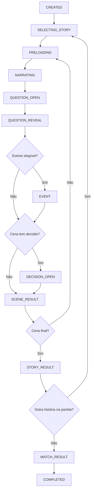

# English Roulette — GAME_RULES.md

> **Versão:** 1.0 — contrato de regras proposto para validação  
> **Data:** 06/11/2026  
> **Referências:** `REQUIREMENTS.md` v1.3, `ARCHITECTURE.md`, `CODING_STANDARDS.md`, `DATABASE.md`  
> **Modos:** `SOLO_ADVENTURE`, `SOLO_PRACTICE`, `MULTIPLAYER` (2–8 pessoas)  
> **Objetivo:** registrar regras verificáveis antes de implementar o motor de jogo em C#.

## 1. O que significa “Game Engine” neste projeto?

**Game Engine não significa Unity ou Unreal.** Neste sistema, é um **conjunto de classes e serviços C# que determina o próximo estado válido do jogo**. Ele não desenha a roleta, não toca MP3 e não monta páginas Blazor: essas são responsabilidades da interface. Ele também não deve depender diretamente de HTTP ou SignalR.

O engine recebe um **comando + estado atual + conteúdo publicado + horário do servidor**, valida e produz uma **transição de estado e seus efeitos**. A camada de aplicação persiste a transição e, depois do commit, publica notificações para os navegadores quando necessário.

Exemplo simples:

```text
Jogador envia resposta
  → API / Hub autentica jogador
  → Application carrega sessão + questão
  → GameEngine valida fase, prazo, formato e regra
  → Application persiste resposta no PostgreSQL
  → Ao encerrar a pergunta, GameEngine calcula pontos e nova fase
  → Application persiste pontos + fase em transação
  → API responde / SignalR notifica resultado
  → Blazor atualiza interface, animação e áudio
```

**Nunca** colocar a regra de pontuação dentro do `.razor`, do Hub ou de um controller. **Nunca** confiar em `IsCorrect`, `Score` ou `RemainingTime` enviados pelo cliente.

### 1.1 Responsabilidades sugeridas

| Componente | Responsabilidade | Exemplo de método C# |
|---|---|---|
| `StoryFlowEngine` | Navegar no grafo de cenas e validar finais | `GetNextScene(...)` |
| `ChallengeEvaluator` | Conferir resposta conforme tipo | `Evaluate(challenge, answer)` |
| `ChallengeSelector` | Escolher pergunta elegível e variar formatos | `SelectNext(...)` |
| `EventSelector` | Sortear somente eventos elegíveis | `SelectEligible(...)` |
| `ScoringEngine` | Calcular pontos conforme modo | `ScoreMultiplayer(...)` |
| `SessionStateMachine` | Autorizar transições de fase | `CanTransition(from, to)` |
| `SessionCoordinator` | Orquestrar comando, transação, idempotência e notificação | `SubmitAnswerAsync(...)` |
| `SessionDeadlineWorker` | Avançar fases vencidas após tempo limite | `ExecuteAsync(...)` |

Os cinco primeiros pertencem ao domínio ou a serviços de regras puras. `SessionCoordinator` pertence à Application; `SessionDeadlineWorker` à hospedagem/infraestrutura. **São papéis lógicos**, não exigência de criar uma classe ou interface para cada linha desde o primeiro commit.

### 1.2 Exemplo de contrato, não implementação pronta

```csharp
public enum GameMode
{
    SoloAdventure,
    SoloPractice,
    Multiplayer
}

public sealed record AnswerEvaluation(
    bool IsCorrect,
    string Explanation);

public sealed record AcceptedAnswer(
    Guid PlayerId,
    Guid QuestionInstanceId,
    DateTimeOffset ReceivedAtUtc,
    bool IsCorrect);

public static class ScoringRules
{
    private static readonly int[] MultiplayerPoints =
        [200, 180, 160, 140, 120, 100, 80, 60];

    public static int MultiplayerPointsForRank(int rank)
    {
        if (rank < 1 || rank > MultiplayerPoints.Length)
            throw new ArgumentOutOfRangeException(nameof(rank));

        return MultiplayerPoints[rank - 1];
    }
}
```

A classe acima não substitui o cálculo completo de faixas de empate; ela demonstra a organização de **uma regra pequena, pura e testável**.

## 2. Constantes e configurações iniciais (propostas)

| Configuração | Default | Regras |
|---|---:|---|
| Jogadores multiplayer | 2–8 | validação obrigatória |
| Histórias por partida multiplayer | 1 | arquitetura pode suportar até 3 após validação |
| Cenas por história | 5–8 | editorial, não constraint de banco para rascunho |
| Duração de narração/cena | 20–45 s | prevalece a duração do arquivo real |
| Tempo por pergunta | 15 s | sobrescrito pela questão, entre 10 e 20 s em desafios comuns |
| Contagem regressiva inicial | 3 s | todos veem previsão de início |
| Janela de empate multiplayer | 300 ms | por horário de chegada ao servidor |
| Tolerância de desconexão | 90 s | não paralisa indefinidamente a sala |
| Chance de evento | 30% | transições elegíveis, parametrizável entre 25%–40% |
| Máximo de eventos | 1 por cena | nunca em meio a pergunta ou áudio |
| Perguntas extras de desempate | 3 | empate persistente = vitória compartilhada |
| XP Adventure por conclusão | regra seção 8 | crédito apenas no fim válido |
| Practice | sem limite de resposta | não há pontos competitivos nem XP de respostas repetidas |

Configurações entram no `settings_snapshot_json` da sessão **antes de começar**. Ajustes administrativos posteriores não mudam regras de partida já iniciada. Uma `scoring_policy_version` torna o cálculo histórico reproduzível.

## 3. Máquina de estados

### 3.1 Estados persistentes compartilhados

Utilizar estados explícitos no domínio; a interface apenas representa o estado oficial.

| Fase (`phase`) | Significado | Comando(s) aceitos |
|---|---|---|
| `CREATED` | sessão criada, configuração congelada | começar/retomar conforme modo |
| `SELECTING_STORY` | seleção/roleta de história | decisão do servidor; seleção autorizada no solo |
| `PRELOADING` | arquivo da cena distribuído e carregamento solicitado | confirmação de áudio pronto |
| `NARRATING` | cena está sendo apresentada/reproduzida | sinais de conectividade; controles locais permitidos |
| `QUESTION_OPEN` | pergunta exibida e recebendo respostas | `SubmitAnswer` / `SubmitPracticeAttempt` |
| `QUESTION_REVEAL` | resultado e explicação liberados | avançar após janela/ack permitido |
| `EVENT` | desafio surpresa elegível em andamento | respostas do evento, quando aplicável |
| `DECISION_OPEN` | escolha de caminho solo ou votação coletiva | `SubmitChoice` ou `SubmitVote` |
| `SCENE_RESULT` | cena concluída; engine decide próxima cena | avanço interno do servidor |
| `STORY_RESULT` | caminho terminou em cena final | próximo story (se configurado) ou fechar sessão |
| `MATCH_RESULT` | resultados/XP/vencedores definidos | revanche (nova sessão) |
| `COMPLETED` | sessão encerrada com sucesso | apenas consultas |
| `CANCELLED` | encerramento técnico/operacional | apenas consultas |

No multiplayer, **a sala** ainda passa por `LOBBY` e `READY_CHECK` antes de criar/iniciar a sessão. No Solo, não existe lobby nem Hub.

### 3.2 Transições permitidas



**Observações:**
- Cena sem pergunta pode avançar diretamente de `NARRATING` para `EVENT`/`DECISION_OPEN`/`SCENE_RESULT`, somente quando essa possibilidade estiver publicada e validada.
- Se há várias perguntas, `QUESTION_REVEAL → QUESTION_OPEN` para a próxima instância; não repetir `NARRATING` entre elas.
- `CANCELLED` pode ser alcançado a partir de qualquer fase ativa por comando administrativo/erro irrecuperável validado.
- `Practice` não usa deadlines obrigatórios de pergunta; a progressão acontece por comando do jogador, com validação.
- **Sempre persistir uma transição antes de emitir um evento de UI.** Uma notificação perdida não altera o resultado: o cliente consulta snapshot.

### 3.3 Contrato de transição

Cada tentativa de transição recebe:

```text
SessionId, ExpectedStateVersion, CommandId, ActorPlayerId?, ServerNowUtc
```

E retorna conceitualmente:

```text
NewPhase, NewStateVersion, NewDeadlineUtc?, PersistedEffects[], PublicEvents[]
```

- Estado incompatível: retornar erro `INVALID_GAME_PHASE` com snapshot atualizado.
- Versão desatualizada: `STATE_CONFLICT`, com opção de buscar estado atual.
- Mesmo `CommandId` + mesmo payload: retornar resultado já registrado, **sem aplicar novamente**.
- Mesmo `CommandId` + payload diferente: `IDEMPOTENCY_CONFLICT`.
- Transições concorrentes e deadlines: comparar a versão em transação; somente uma operação vence.

## 4. História, cena, áudio e decisões

### 4.1 Iniciar história

1. Selecionar apenas `StoryVersion` publicada, licenciada, com dificuldade e gênero elegíveis.
2. No multiplayer, sorteio e roleta são **cosméticos após a decisão do servidor**; todos recebem o mesmo resultado.
3. No solo, jogador pode escolher história ou `Surprise Me`.
4. Fixar `StoryVersionId` no percurso e carregar a `StoryScene` inicial (`START`).
5. Persistir o início do percurso e a cena visitada.

### 4.2 Preparar e narrar uma cena

- Carregar apenas mídia publicada e associada à versão vigente; o cliente obtém URL de áudio sem acessar arquivos privados.
- Exigir gesto inicial `Enable audio` para evitar bloqueios de autoplay dos navegadores.
- Multijogador: API solicita pré-carregamento de todos; a cena inicia quando os conectados elegíveis confirmam `AudioReady`, com **timeout configurável de preparação**.
- Jogador que falhar no áudio recebe erro/retry; a partida não fica travada indefinidamente. Ao esgotar timeout, tratar por política explícita de ausência/desconexão (seção 10), nunca fingir que o áudio tocou.
- O servidor informa `startsAtUtc` e `narrationEndsAtUtc`; cada navegador reproduz o arquivo localmente. Áudio não trafega pelo SignalR.
- Não confiar em `audio.ended` de um navegador para abrir a pergunta: o servidor abre após deadline da narração e margem configurada.
- `Blind Listening`: texto oculto durante reprodução; só revelar quando a regra do desafio permitir.
- Perguntas não devem revelar texto de cenas futuras ou de caminhos não visitados.

### 4.3 Escolhas de caminho

**Solo:** o jogador escolhe uma transição de saída válida (`DecisionChoice`). O engine muda para a cena destino correspondente, sem votação.

**Multiplayer:** cada participante ativo pode votar uma vez na transição (`PlayerVote`). Votos não são editáveis após aceitação.

Regra de resolução proposta:

1. Contar votos válidos recebidos até `closesAtUtc`.
2. Escolher a alternativa com **maior número de votos** (pluralidade).
3. Em empate, realizar sorteio auditável entre as empatadas, no servidor.
4. Sem votos válidos, usar transição marcada `is_default`; se inexistente, selecionar uma transição válida por sorteio registrado.
5. Persistir alternativa, regra aplicada e próxima cena na **mesma transação**.
6. A escolha narrativa **não concede nem retira pontos**. Ela determina apenas o rumo e o final.

Exemplo: A=3 votos, B=3, C=2 → sorteio somente entre A e B. O sorteio deve aceitar `IRandomSource`/fonte de aleatoriedade injetável para permitir testes determinísticos.

## 5. Perguntas: elegibilidade e resposta

### 5.1 Selecionar questão

Critérios obrigatórios, em ordem:

1. Questão da **mesma StoryVersion** jogada e vinculada à cena atual (ou retrospectiva cuja cena exigida foi visitada).
2. Nível e modo compatíveis com a sessão.
3. Questão e alternativas publicadas/validadas, com gabarito íntegro.
4. Não utilizada antes na mesma partida.
5. Preferir habilidade/tipo diferente dos últimos desafios, quando houver opções.
6. Preferir variantes não vistas recentemente pelo jogador/grupo, se houver histórico.
7. Se não houver alternativa, permitir questão obrigatória ainda não usada; se não existir nenhuma, seguir fallback explícito de publicação/erro, **não entrar em loop de sorteio**.

O banco fornece as variantes; não gerar perguntas ou alterar gabaritos em runtime com IA.

### 5.2 Tipos e avaliação

| Tipo | Entrada pública | Avaliação no servidor |
|---|---|---|
| `MULTIPLE_CHOICE` | `optionId` | igual à alternativa correta |
| `TRUE_FALSE` | `optionId` ou boolean conforme contrato | igualdade exata |
| `MISSING_WORD` | `optionId` | alternativa correta |
| `WHO_SAID_IT` | `optionId` | personagem válido |
| `MEMORY_RECALL` | `optionId` | fato de cena já visitada |
| `FIND_THE_LIE` | `optionId` | única afirmação incorreta |
| `SEQUENCE_ORDER` | array ordenado de `tokenKeys` | igualdade exata da ordem |
| `SCRAMBLED_SENTENCE` | array ordenado de `tokenKeys` | igualdade exata da ordem |

Na V1 **não usar avaliação subjetiva** de texto livre. Validar que os IDs/tokens pertencem ao desafio e que nenhum está duplicado/ausente.

### 5.3 Abertura de pergunta

- Persistir `QuestionInstance` com `opensAtUtc`, `closesAtUtc`, `questionNumber`, opções embaralhadas pelo servidor, multiplicador e estado `OPEN`.
- Enviar `PublicQuestionDto`, sem gabarito, explicação ou campos internos.
- A ordem embaralhada é **a mesma para toda a sala** na instância multiplayer; no solo pode ser própria da sessão.
- Mostrar cronômetro local apenas como reflexo do prazo oficial.
- A pergunta fecha no prazo definido, ou pode fechar cedo se **todos os participantes elegíveis** já responderam, em operação autoritativa.

### 5.4 Aceitar resposta

Validação, nesta sequência:

1. Usuário autenticado e participante da sessão.
2. Questão pertence à sessão e está aberta.
3. `ServerNowUtc` pertence ao intervalo `[opensAtUtc, closesAtUtc)`.
4. Resposta usa payload adequado ao tipo e opções/tokens publicados.
5. Jogador não tem resposta previamente aceita para esta instância.
6. Inserir resposta com timestamp obtido **no backend** e `requestId`.

- Repetição idempotente do mesmo envio devolve o mesmo protocolo de aceite.
- Enviar resposta errada válida **consome a tentativa** em Multiplayer e Solo Adventure.
- Não informar `IsCorrect` ao jogador multiplayer enquanto a pergunta estiver aberta; isso evita sinalização da resposta para outros participantes.
- Em `SoloAdventure`, revelar feedback quando a resposta individual é confirmada e sua questão é encerrada.
- `SoloPractice` permite novas tentativas de estudo, sem pontos de velocidade; manter histórico de `PracticeAttempt`.

### 5.5 Eventos especiais

`SPEED_CHALLENGE` cria uma sequência de três instâncias com prazos reduzidos. `FINAL_BOSS`, `MEMORY_RUSH`, `FIND_THE_LIE` etc. **reutilizam `ChallengeEvaluator`** e seus gabaritos. Não criar um avaliador diferente para cada animação.

## 6. Pontuação multiplayer: acerto e ordem de chegada

**Regra autoritativa:** pontuação é apurada **somente ao fechar a pergunta**. Apenas respostas corretas aceitas dentro do prazo são classificadas. Respostas erradas/sem envio = 0.

### 6.1 Pontos padrão por posição entre acertos

| Posição | Pontos |
|---:|---:|
| 1ª | 200 |
| 2ª | 180 |
| 3ª | 160 |
| 4ª | 140 |
| 5ª | 120 |
| 6ª | 100 |
| 7ª | 80 |
| 8ª | 60 |

Exemplo com 8 jogadores: se somente 3 acertam, eles ganham **200, 180 e 160**. Os cinco restantes ganham **0**.

### 6.2 Faixa de empate de 300 ms

Para reduzir injustiça de milissegundos, respostas corretas com diferença de até 300 ms **a partir da primeira resposta do grupo** recebem a mesma posição/pontuação.

Algoritmo determinístico:

1. Ordenar acertos por `received_at_utc` ascendente; critério estável secundário por `player_id` somente para reprodução dos dados.
2. O primeiro acerto ainda não agrupado abre uma faixa (âncora temporal).
3. Incluir na faixa respostas cuja diferença para a **âncora** seja `<= 300 ms`.
4. Todos recebem os pontos correspondentes à **primeira posição da faixa**.
5. A próxima faixa começa na posição `1 + quantidade total de acertos anteriores` (**ranking de competição**).

Exemplo: P1 em 12:00:00.100 e P2 em 12:00:00.250 recebem 200 cada; P3 em 12:00:00.700 recebe 160 (posição 3), não 180. **Não agrupar por efeito dominó** comparando cada resposta à imediatamente anterior.

### 6.3 Bônus e fechamento

`FinalPoints = BasePointsByCorrectRank × ScoringMultiplier`, usando multiplicadores controlados pelo servidor (normalmente 1 ou 2). Arredondamento: para inteiro mais próximo, `MidpointRounding.AwayFromZero`, caso multiplicadores fracionários sejam autorizados futuramente.

`ScoreAward` possui chave única de origem para impedir crédito repetido. Atualizar `score_total`, lançamentos, ranks e fase em transação. **Não pontuar resposta antes do fechamento** nem confiar na ordem de recebimento exibida pelo cliente.

**Limitação declarada:** relógio de servidor reduz fraudes, mas latência desigual ainda influencia posições. Não prometer competição perfeitamente justa em redes diferentes; para partidas ranqueadas no futuro, revisar compensação de ping e/ou faixas de tempo maiores.

## 7. Single Player: Adventure e Practice

### 7.1 Solo Adventure

- Uma história narrada por vez; pergunta com limite de tempo e uma resposta pontuável.
- A mesma avaliação de resposta do multiplayer é reutilizada.
- **Não existe posição de acerto**; o bônus depende da proporção de tempo restante da pergunta.

Tabela de pontos proposta por resposta correta:

| Tempo restante ao responder | Pontos |
|---|---:|
| `>= 70%` do limite | 150 |
| `>= 40%` e `< 70%` | 125 |
| `> 0%` e `< 40%` | 100 |
| Errada ou expirada | 0 |

`remainingRatio = clamp((closesAtUtc - receivedAtUtc) / (closesAtUtc - opensAtUtc), 0, 1)`.

Em evento `DOUBLE_POINTS`, multiplicar a pontuação da faixa por 2. A regra acima é **proposta para aprovação**, não valor imutável de produto.

- Após resposta validada, apresentar feedback e permitir avançar.
- Registro de tempo/score sempre no backend.
- Ao concluir, registrar final obtido, taxa de acerto, recorde e XP de conclusão.

**Salvar e continuar sem exploração de resposta:** quando o jogador sai em `QUESTION_OPEN`, o prazo continua correndo no servidor até expirar. Ao retornar, se o prazo tiver vencido, a questão é encerrada sem pontuar. Não reiniciar a pergunta com tempo integral. Se a interrupção ocorrer **entre questões/cenas**, a sessão retoma da fase persistida normalmente.

### 7.2 Solo Practice

- Sem cronômetro competitivo; jogador pode repetir áudio, pausar, rever texto, consultar explicações e tentar novamente.
- A primeira tentativa pode alimentar estatísticas de estudo, sem pontos competitivos; tentativas adicionais ficam em `PracticeAttempt`.
- Não conceder pontos/XP por repetir indefinidamente uma mesma questão.
- Pode sair e continuar na mesma cena, preservando o último estado.
- Escolhe caminhos individualmente; salvar todas as escolhas.
- Pausas/repetições só mudam a experiência local e os marcadores de progresso necessários; não alteram versões publicadas.

### 7.3 Comparação dos modos

| Regra | Adventure | Practice | Multiplayer |
|---|---|---|---|
| Sala/SignalR | Não | Não | Sim |
| Pergunta com prazo | Sim | Não | Sim |
| Repetir questão | Não, se pontuável | Sim, sem recompensa | Não |
| Velocidade pontua | Faixas percentuais | Não | Ordem dos acertos |
| Próxima cena | Escolha individual | Escolha individual | Voto coletivo |
| XP por conclusão | Sim | Não por repetição; padrão V1 sem XP | Sim |
| Replay | Sim, recompensa reduzida | Sim | Revanche com nova sessão |

## 8. XP, conquistas e ranking

### 8.1 Separação conceitual

- **Score**: pontos competitivos **dentro daquela `GameSession`**, zerados em nova sessão.
- **XP**: progressão persistente do jogador, não interfere na ordem da sala.
- **Achievement**: conquista persistente cuja condição é calculada com histórico confiável.

### 8.2 Política proposta para V1

| Caso | XP |
|---|---:|
| Adventure concluído, primeira conclusão daquela `StoryVersion` | `30 + 10 × acertos`, limitado a 100 |
| Adventure concluído, repetição da mesma versão | `floor(XP normal / 2)`, limitado a 50 |
| Multiplayer concluído como participante elegível | `30 + 10 × acertos`, limitado a 100 |
| Practice, mesmo após completar | 0 na V1 |
| Sessão cancelada/abandonada antes do fim | 0 |

- Conceder XP **uma vez por `session_id`, `player_id` e tipo de recompensa**.
- Repetição detectada por histórico de sessões anteriores concluídas para aquela versão; nunca usar somente estado local do navegador.
- Para reduzir farming, só recompensar conclusão legítima após participação mínima e interação efetiva; critérios detalhados podem ser ajustados ao validar a experiência.
- `players.total_xp` é saldo; `xp_awards` é histórico contábil.

### 8.3 Conquistas

Códigos iniciais: `FIRST_VICTORY`, `PERFECT_SCENE`, `SPEED_MASTER`, `BOOKWORM`, `VOCABULARY_MASTER`, `COMEBACK`, `EXPLORER`. Calcular condição com dados persistidos; lançar `PlayerAchievement` apenas uma vez, depois da transação de conclusão. Conquista ganha não pode ser duplicada por retry.

### 8.4 Resultado e empate multiplayer

1. Ordenar participantes elegíveis por `score_total`.
2. Empate na liderança → até 3 perguntas extras entre os empatados, com regras de pontuação normais e igualdade de oportunidades.
3. Persistindo empate, declarar **vencedores compartilhados**.
4. Empate fora da liderança: mesma posição no placar, sem forçar desempate.
5. Jogador abandonado recebe o score histórico, mas não é elegível a premiação de vencedor da partida se a regra de abandono já o excluiu.

## 9. Eventos surpresa e antirrepetição

### 9.1 Seleção elegível

O evento precisa estar ativo, suportar o modo, ter conteúdo preparado, ocorrer em fase válida e não repetir o evento imediatamente anterior. Eventos não acontecem durante narração nem durante resposta.

Elegibilidade inicial:

| Evento | Solo Adventure | Solo Practice | Multiplayer |
|---|:---:|:---:|:---:|
| `BLIND_LISTENING` | Sim | Sim | Sim |
| `DOUBLE_POINTS` | Sim | Não | Sim |
| `MEMORY_RUSH` | Sim | Sim | Sim |
| `FIND_THE_LIE` | Sim | Sim | Sim |
| `SPEED_CHALLENGE` | Sim | Não | Sim |
| `MISSING_WORD` | Sim | Sim | Sim |
| `SCRAMBLED_SENTENCE` | Sim | Sim | Sim |
| `MYSTERY_BOX` | Sim | Versão sem pontos | Sim |
| `FINAL_BOSS` | Sim | Versão sem tempo | Sim |

### 9.2 Frequência

- Proposta de 30% de chance **após uma cena elegível**, com no máximo 1 evento por cena e intervalo mínimo de uma cena sem evento entre aparições.
- `FINAL_BOSS` é evento de fechamento e não entra no sorteio comum.
- Se o conteúdo compatível não existir, pular o evento e continuar; **não escolher questão de outro nível ou de caminho não visitado**.
- Registrar o evento e a configuração congelada usada naquela sessão.
- Recompensas coletivas como `DOUBLE_POINTS` aplicam-se a todos da mesma forma.

### 9.3 Antirrepetição

1. Excluir história já disputada na mesma partida.
2. Priorizar histórias pouco vistas pelo grupo/jogador, considerando versão e gênero.
3. Nunca repetir o mesmo `ChallengeId` dentro da sessão.
4. Alternar tipos de questões e habilidades, quando houver conteúdo suficiente.
5. Alternar eventos elegíveis; não repetir consecutivamente.
6. Não mostrar pergunta sobre uma cena/caminho não visitado.
7. Quando o banco de conteúdo for insuficiente, aplicar fallback **visível e determinístico** (ex.: permitir replay de história já jogada), sem erro infinito nem falso conteúdo “novo”.

**Meta editorial:** expandir catálogo continuamente pelo painel; novas histórias não demandam nova versão do software.

## 10. Reconexão, abandono, encerramento e falhas

### 10.1 Multiplayer

- **90 s de tolerância** ao perder conexão é proposta inicial. Marcar `DISCONNECTED`, não remover a participação instantaneamente.
- No reconnect: autenticar convidado, validar associação `room_participants`, reingressar no grupo SignalR e emitir **snapshot** da sessão (nunca depender de replay de mensagens antigas).
- Perguntas e timers permanecem no relógio do servidor; um jogador desconectado não ganha tempo extra automaticamente.
- Durante uma pergunta, se o jogador não responder até o prazo, marcar como timeout; outros jogadores continuam.
- Em decisões coletivas, contar somente votos válidos recebidos no prazo; ausência equivale a abstenção.
- Se abandono deixar menos de 2 jogadores ativos, concluir/cancelar por política de sessão documentada: na V1, **encerrar como `CANCELLED`**, preservando histórico e sem declarar vencedor, em vez de mudar silenciosamente para solo.
- Caso falha generalizada de áudio/servidor impossibilite integridade da partida, `CANCELLED` + motivo auditável.

### 10.2 Solo

- `Practice`: pode parar em qualquer ponto e continuar sem perda de pontos (não existem pontos de velocidade).
- `Adventure`: respeitar deadlines já abertos; não restaurar um cronômetro vencido, mas permitir continuar a narrativa.
- Sessão abandonada por prazo de retenção futuro deve ser marcada `ABANDONED`; não premiar conclusão automática.

### 10.3 Infra e idempotência

- Estado e deadlines persistidos no PostgreSQL.
- Um worker interno retoma transições vencidas ao reiniciar a API; o worker não deve emitir eventos antes do commit.
- Dois comandos concorrentes de resposta/avanço não podem gerar duas transições válidas: controle de versão/lock de banco.
- Se commit ocorrer e a notificação falhar, cliente obtém estado correto por snapshot.
- Não confiar em grupos SignalR como banco de participantes; grupo precisa ser refeito na reconexão.

## 11. Contratos de comandos, snapshots e erros

### 11.1 Comandos

| Comando | Modo | Regra essencial |
|---|---|---|
| `CreateSoloSession` | Solo | cria `GameSession` com 1 participante |
| `StartStory` | Todos | fixa `StoryVersion` elegível |
| `ConfirmAudioReady` | Multiplayer | confirma asset/cena atual e cliente autenticado |
| `SubmitAnswer` | Adventure/Multiplayer | uma resposta pontuável por instância |
| `SubmitPracticeAttempt` | Practice | várias tentativas ordenadas sem pontos |
| `SubmitChoice` | Solo | escolha entre transições da cena |
| `SubmitVote` | Multiplayer | um voto por jogador/decisão |
| `FinishQuestion` | Backend | fechamento e score idempotentes |
| `AdvanceScene` | Backend/solo conforme fase | transição do grafo, sem pular requisitos |
| `ResumeSession` | Solo | retorna snapshot de estado ativo |
| `RequestCurrentState` | Multiplayer | snapshot após reconexão |

### 11.2 Snapshot público mínimo

```json
{
  "sessionId": "<uuid>",
  "mode": "MULTIPLAYER",
  "stateVersion": 12,
  "phase": "QUESTION_OPEN",
  "serverNowUtc": "<ISO-8601>",
  "phaseDeadlineUtc": "<ISO-8601>",
  "story": { "title": "...", "difficulty": "A2" },
  "scene": { "sceneKey": "forest-02", "imageUrl": "..." },
  "question": { "id": "<uuid>", "prompt": "...", "options": [] },
  "participants": [{ "playerId": "<uuid>", "score": 200 }],
  "myAnswerAccepted": false
}
```

O exemplo mostra a **estrutura**, não dados reais. Durante `QUESTION_OPEN`, não serializar resposta correta, explicação, outros votos ainda ocultos, hash de credenciais, URL privada de rascunho ou gabarito embutido.

### 11.3 Erros esperados

`INVALID_GAME_PHASE`, `STATE_CONFLICT`, `DEADLINE_EXPIRED`, `ALREADY_ANSWERED`, `INVALID_ANSWER`, `INVALID_CHOICE`, `NOT_PARTICIPANT`, `CONTENT_NOT_PUBLISHED`, `MEDIA_UNAVAILABLE`, `IDEMPOTENCY_CONFLICT`, `ROOM_FULL`, `SESSION_FINISHED`.

Usar `ProblemDetails` para REST e um envelope de erro estável nos comandos SignalR. Clientes devem exibir mensagem humana, não stack trace.

## 12. Testes obrigatórios do engine

| ID | Cenário | Resultado esperado |
|---|---|---|
| ENG-001 | Start em versão `DRAFT` | rejeitar |
| ENG-002 | Próxima cena aponta para outra versão | rejeitar na publicação/execução |
| ENG-003 | Escolha de caminho não existe na cena | rejeitar |
| ENG-004 | Jogador responde depois do prazo | 0 pontos; registrar timeout conforme política |
| ENG-005 | Resposta duplicada (mesma request) | retorna resultado anterior, sem duplicar |
| ENG-006 | Resposta alterada após primeira aceita | conflito; manter primeira |
| ENG-007 | Duas respostas corretas a 200 ms | mesma faixa de pontos |
| ENG-008 | Próximo acerto após a janela de empate | recebe posição seguinte considerando acertos anteriores |
| ENG-009 | 3 acertos e 5 erros | 200/180/160 para acertos, demais 0 |
| ENG-010 | `DOUBLE_POINTS` | todos os elegíveis recebem multiplicador idêntico |
| ENG-011 | Empate de votação | sorteio só entre empatadas, registrado |
| ENG-012 | Ausência de votos | transição default ou fallback registrado |
| ENG-013 | Pergunta de caminho não visitado | inelegível |
| ENG-014 | Evento repetido consecutivamente | inelegível |
| ENG-015 | Reconexão durante pergunta | snapshot consistente; prazo não reinicia |
| ENG-016 | Adventure sai durante pergunta | prazo continua, sem segunda chance pontuável |
| ENG-017 | Practice repete pergunta 5 vezes | histórico de tentativa, 0 XP de repetição |
| ENG-018 | Duas chamadas encerram mesma pergunta | apenas um score/avanço |
| ENG-019 | Reenviar conclusão de sessão | apenas um crédito XP |
| ENG-020 | Versão nova de história publicada | sessão antiga permanece na versão original |
| ENG-021 | Falha de mídia publicada | bloquear preparação e emitir erro recuperável |
| ENG-022 | Jogador desconectado reaparece | volta ao grupo autorizado e recupera snapshot |
| ENG-023 | Sala passa de 8 participantes | rejeitar nono jogador |
| ENG-024 | Story graph sem final alcançável | falha na publicação |

**Tipos de teste:** regras puras com xUnit; banco real PostgreSQL em integração; duas janelas/navegadores no teste ponta a ponta de SignalR; replay de comando com `requestId` idêntico. Injetar relógio (`TimeProvider`) e aleatoriedade para resultados determinísticos.

## 13. Plano de implementação orientado a aprendizado

### Slice 1 — Primeiro fluxo solo jogável

1. Criar projetos .NET, PostgreSQL e migrations mínimas.
2. Cadastrar **uma história original ou licenciada**, três cenas, áudio e uma pergunta por cena.
3. Implementar `StoryFlowEngine.GetNextScene` com testes.
4. Implementar `ChallengeEvaluator` para `MULTIPLE_CHOICE`.
5. Criar `GameSession` solo, abrir a pergunta e aceitar uma resposta.
6. Persistir resposta/score, avançar para próxima cena e continuar após atualizar a página.
7. Conectar Blazor: texto, player de áudio, alternativas, feedback e progresso.

### Slice 2 — Ramificações e Practice

- Escolhas individuais, finais alternativos, pausa/replay e tentativas de estudo.
- História publicada imutável e painel básico para conteúdo.

### Slice 3 — Multiplayer real

- Salas 2–8, autenticação de convidados, SignalR, áudio preparado e sincronização.
- Pontuação por ordem/empate, votação coletiva e snapshot de reconexão.

### Slice 4 — Conteúdo e diversão

- Eventos, novos tipos de perguntas, animações, XP, conquistas, antirrepetição, ferramentas de publicação.

### Slice 5 — VPS e operação

- Docker Compose, Traefik, PostgreSQL, volume de mídias, backups externos, health checks, métricas e deploy automatizado.

**Padrão de uso de IA no desenvolvimento:** para cada slice, primeiro explicar a regra desejada, pedir uma implementação pequena com teste, revisar o diff e só então seguir. O objetivo não é copiar uma “engine pronta”, mas **entender por que cada transição é válida ou inválida**.

## 14. Decisões para validação antes da pontuação definitiva

- [ ] 1 história por sessão inicialmente; até 3 quando o fluxo estiver estável.
- [ ] Faixa de empate multiplayer de 300 ms e ranking de competição (pulos em posições empatadas).
- [ ] Pontos de Multiplayer: 200/180/160/140/120/100/80/60.
- [ ] Pontos de Adventure: 150/125/100 para respostas corretas conforme tempo restante.
- [ ] XP: fórmula proposta e redução em replay; Practice sem XP na V1.
- [ ] Votação por pluralidade, empate resolvido por sorteio entre alternativas empatadas.
- [ ] Prazo de resposta Adventure segue contando ao sair da página.
- [ ] Cancelar partida multiplayer se restar menos de 2 jogadores ativos após tolerância.
- [ ] Chance inicial de eventos de 30%, respeitando elegibilidade e intervalo.
- [ ] Pré-carregamento e timeout de mídia definidos com base em testes reais de rede móvel.

## 15. Referências técnicas

- `DATABASE.md` — integridade, entidades e concorrência.
- `ARCHITECTURE.md` — divisão do monólito, hospedagem e storage.
- `CODING_STANDARDS.md` — estilo C#, testes e fluxo com IA.
- EF Core: https://learn.microsoft.com/en-us/ef/core/saving/concurrency
- SignalR groups: https://learn.microsoft.com/en-us/aspnet/core/signalr/groups
- ASP.NET Core background tasks: https://learn.microsoft.com/en-us/aspnet/core/fundamentals/host/hosted-services

> **Critério para dizer que existe um Game Engine:** dado um estado e um comando, você consegue testar em C# qual será o próximo estado e quais consequências serão produzidas **sem abrir o navegador**. Isso já é um motor de jogo, mesmo que a interface ainda seja simples.
