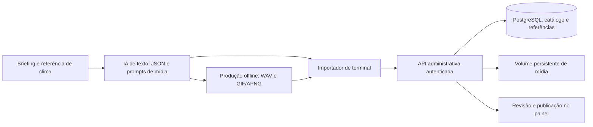
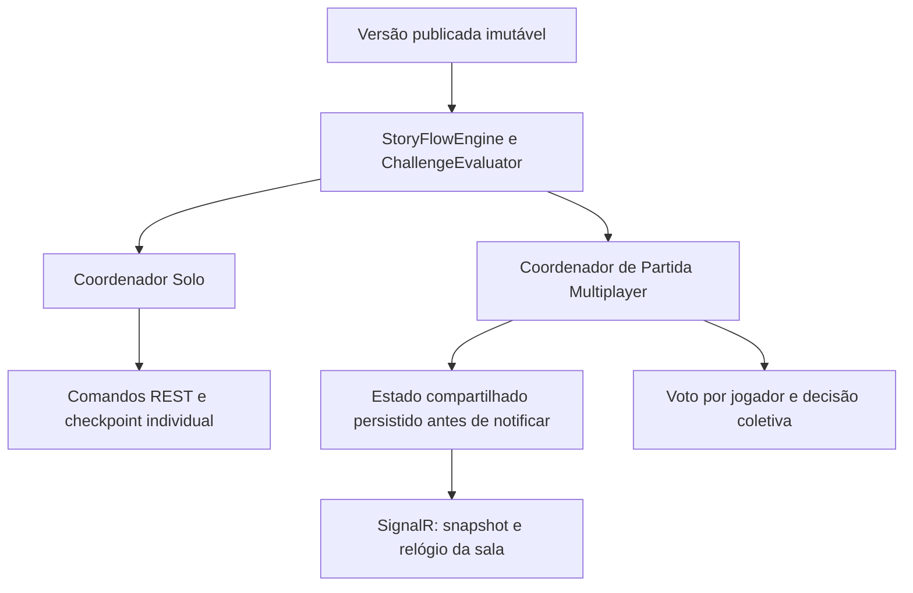

# Autoria de histórias com IA, áudio e animação

O fluxo deste incremento é **briefing → JSON editorial → arquivos de mídia → rascunho no catálogo → revisão/publicação**. A geração acontece antes de jogar. O jogo usa conteúdo pronto e versionado.

Arquivos prontos para usar:

- [`prompts/STORY_AUTHORING.pt-BR.txt`](prompts/STORY_AUTHORING.pt-BR.txt): prompt completo com briefing, níveis, grafo, perguntas, pistas, voz e animação por cena.
- [`prompts/STORY_BRIEF_HORROR_A2.pt-BR.txt`](prompts/STORY_BRIEF_HORROR_A2.pt-BR.txt): pedido preenchido de terror psicológico adulto A2 para enviar junto do prompt completo.
- [`../content/examples/green-ribbon-a2.json`](../content/examples/green-ribbon-a2.json): história original completa A2, quatro cenas físicas, dois finais e três cenas por percurso.
- [`../content/examples/green-ribbon-a2.media.example.json`](../content/examples/green-ribbon-a2.media.example.json): manifesto de arquivos WAV e GIF/APNG para completar com créditos e direitos.
- [`../scripts/import_story.py`](../scripts/import_story.py): ponte de terminal que grava rascunhos e envia mídia pelas rotas administrativas existentes.

## Seu PC ou a VPS?

O mesmo importador pode executar no seu PC ou no terminal da VPS. Precisa de Python 3 e acesso HTTPS à aplicação. Ele usa **e-mail e senha de administrador da aplicação**, não a chave SSH. A senha é solicitada sem eco no terminal; para automação, existem `ENGLISHROULETTE_ADMIN_EMAIL` e `ENGLISHROULETTE_ADMIN_PASSWORD`. Cookies e tokens ficam em memória e não são gravados no disco.

Sua chave `~/.ssh/englishroulette_deploy` permite abrir o terminal da VPS quando o servidor autoriza sua chave pública. Ela não concede acesso a um serviço de IA nem define o login do painel. Para gerar texto/voz/animação por uma API de IA, será necessária a credencial desse serviço. Para rodar modelos no PC/VPS, precisamos escolher modelos e conhecer CPU, RAM, GPU e armazenamento disponíveis; o suporte de importação não exige instalar esses modelos na VPS.

A primeira opção operacional é gerar o JSON e as mídias com as ferramentas que você escolher no seu PC, depois enviar o pacote por HTTPS. O tráfego e os arquivos não passam por um túnel PostgreSQL. A API autentica ADMIN, valida o conteúdo e grava no banco com as regras e transações do catálogo.



A ponte implementada importa JSON e arquivos existentes. Ela **não contém um cliente de um provedor de IA** nem gera voz/vídeo automaticamente. O adaptador de geração será escolhido separadamente; o prompt já define o que cada ferramenta deve produzir. Também não executa SQL arbitrário nem publica automaticamente.

## Conteúdo e níveis

Use a referência como briefing de clima ou situação genérica: isolamento, explorar um prédio vazio, seguir pistas, amizade, mistério escolar. A história de exemplo conta a evacuação de uma clínica após uma tempestade, com Eva e fitas verdes indicando ajuda. Personagens, causas, falas e desfechos são próprios. Não depende de conhecer The Walking Dead ou um anime.

O catálogo atual aceita A1, A2, B1, B2 e C1. O CEFR descreve competências; as faixas de palavras do prompt são metas editoriais propostas para este projeto, não regras oficiais ou certificação automática. Faça revisão humana do nível. Referência: [escala global CEFR do Conselho da Europa](https://www.coe.int/en/web/common-european-framework-reference-languages/table-1-cefr-3.3-common-reference-levels-global-scale).

Para oferecer a mesma premissa em vários níveis, gere **um JSON e uma história independente por nível**. No modelo atual há apenas uma versão publicada por história: publicar A1 como nova versão da mesma história A2 arquivaria A2. Use versões para revisar uma variante; um agrupamento futuro de famílias pedagógicas pode relacioná-las.

As pistas são elementos da narração e da arte, com perguntas respondíveis pelo texto. O motor atual suporta escolhas de caminho, mas não inventário, combate, scripts de missão ou condições programadas. `productionNotes` e `authoringNotes` permanecem no arquivo local; só os campos suportados pelo catálogo são persistidos.

## Como usar

Envie o arquivo `STORY_AUTHORING.pt-BR.txt` à IA junto de um pedido específico. Você pode copiar o briefing de `STORY_BRIEF_HORROR_A2.pt-BR.txt` e trocar nível, premissa, personagem, local e pistas. Os valores do pedido específico substituem os exemplos do prompt principal. O nível define a complexidade do inglês; A2 também pode ser usado para público adulto e tom sério.

O prompt principal agora inclui direção de terror psicológico, imagens em estilo de animação 2D e loops discretos. Cada `imagePrompt` deve especificar momento, cenário, personagens, pistas, câmera, luz e continuidade. Cada `animationPrompt` deriva da imagem-base e escolhe um ou dois movimentos periódicos. `authoringNotes.visualContinuity` registra personagens, planta do local e pistas; permanece somente no pacote local e não exige mudança no backend. O exemplo antigo `green-ribbon-a2.json` continua sendo uma aventura leve; não foi convertido em terror nem teve suas mídias substituídas.

Depois de revisar o JSON, envie o `imagePrompt` de cada cena à ferramenta de imagens. Para cenas posteriores, forneça também as imagens aprovadas anteriores como referência de personagem e continuidade, quando a ferramenta permitir. Para animar, forneça **a imagem-base aprovada daquela cena** junto do respectivo `animationPrompt`; só o texto não garante que a ferramenta preserve a composição. Produza a voz a partir de `audioText`, seguindo `voiceDirection`. Esses prompts são instruções de produção, não uma integração automática com um gerador de mídia.

1. Copie o prompt e preencha nível, gênero, premissa, protagonista e 3–5 cenas. Gere uma resposta JSON completa.
2. Salve como `historia-a2.json` e confira o formato:

```sh
python3 scripts/import_story.py historia-a2.json --check
```

3. Produza a narração de cada `audioText`, que deve ser idêntico a `narration`. Use voz gravada ou síntese autorizada. Produza as animações a partir de `imagePrompt` e `animationPrompt`, mantendo personagens e pistas consistentes. O JSON do exemplo contém instruções, **não arquivos de mídia já produzidos**.
4. Organize o pacote, por exemplo:

```text
meu-pacote/
  historia-a2.json
  media.json
  audio/
    quiet-room.wav
    radio-hall.wav
    garden-rescue.wav
    roof-signal.wav
  animations/
    quiet-room.gif
    radio-hall.gif
    garden-rescue.gif
    roof-signal.gif
```

5. Copie o manifesto de exemplo para `media.json`, preencha créditos e evidências reais por arquivo e confira tudo:

```sh
python3 scripts/import_story.py meu-pacote/historia-a2.json \
  --media-manifest meu-pacote/media.json --check
```

6. Importe para a aplicação:

```sh
python3 scripts/import_story.py meu-pacote/historia-a2.json \
  --media-manifest meu-pacote/media.json \
  --url https://english.seudominio.com.br \
  --email admin@seudominio.com.br
```

O comando pede a senha administrativa, cria um rascunho, salva as cenas, envia cada arquivo usando a revisão atualizada e lista as pendências de publicação. `--media-manifest` exige áudio e visual para todas as cenas. Sem esse argumento, importa somente texto e perguntas; você pode adicionar mídia no painel depois.

O ID do rascunho é impresso antes da gravação das cenas. Se houver falha, confira o painel antes de repetir. Para atualizar/retomar **esse mesmo rascunho**, acrescente `--version-id UUID_IMPRESSO`. Sem esse parâmetro, cada execução cria outra história. O importador preserva IDs e mídia de cenas existentes com a mesma chave; mudar o texto exige reenviar a narração correspondente. Versões publicadas precisam ser duplicadas no painel antes de editar.

Nenhum importador descobre automaticamente se uma senha está correta ou se você tem direitos de distribuição: autenticação, validações de mídia e revisão continuam necessárias. As evidências vazias no exemplo são intencionais; não invente autorizações.

## Áudio e animação

- Áudio atual: WAV PCM 16 bits, até 10 MB e dois minutos por cena. O servidor calcula duração e checksum. MP3 ainda não é aceito pelo upload atual.
- Visual: GIF ou APNG animados, até 8 MB, 4096 px por dimensão, 8 megapixels, 120 quadros e 50 megapixels acumulados. PNG/JPEG estáticos também são aceitos pelo catálogo, mas não satisfazem `animated: true` no manifesto.
- Alvo simples para animação: 640×360, seis segundos e oito quadros por segundo. É um loop visual; não precisa durar o mesmo tempo da narração.
- Os arquivos são referenciados relativamente à pasta do manifesto; arquivos fora dela e caminhos por links para fora são rejeitados. Não são baixadas URLs indicadas pela IA.
- O servidor valida os bytes reais. `--check` confere o formato e os arquivos locais; não substitui essas validações.
- A animação é ativada pelo jogador, pode ser ocultada e não controla o cronômetro. A narração tem o prazo determinado pelo servidor. O importador não altera essa política.

## Arquitetura de gameplay compartilhado

Uma `StoryVersion` publicada fornece cenas, perguntas, caminhos, tema e mídia para ambos os modos. Não gere uma cópia da história para multiplayer e outra para solo.



**Já implementado:** catálogo versionado, mídia/temas, motor de caminhos e correção, Solo Adventure com prazos e retomada, identidade de convidado e lobby multiplayer com prontidão e escolha de história.

**Próxima implementação de gameplay:** preloading de todos, `startsAtUtc` comum, narração, pergunta simultânea, fechamento pelo relógio do servidor, avaliação por participante, revelação, voto e próxima cena. O grupo segue o mesmo caminho. Como proposto em REQUIREMENTS, empate de votos será resolvido no servidor; regras de pontuação/XP ainda precisam ser aprovadas. Practice também continua pendente.

O coordenador multiplayer deve congelar a versão no início, persistir comandos idempotentes por RequestId, impor uma resposta/voto por jogador e usar StateVersion para evitar avanço duplicado. Gabaritos só saem nas rotas editoriais autenticadas ou no resultado autorizado da questão fechada. Áudio e animações são baixados por HTTP, sem enviar bytes pelo SignalR. A IA fica no fluxo editorial, fora dos timers e da correção da partida.

## Preferência visual e envio autorizado à VPS

A preferência atual do responsável é **animação 2D cinematográfica**, com personagens desenhados e cenários pintados, sem aparência de pessoas reais. Essa direção foi aplicada aos 60 prompts de imagem e animação da [Antologia 01](../content/anthology-01/README.md), ao prompt principal e ao briefing de terror. Os roteiros, gabaritos e percursos permanecem os mesmos. O estilo gráfico não depende de a mídia estar em movimento: uma imagem-base estática também deve ter esse desenho.

O responsável autorizou nesta sessão o envio das 12 histórias ao banco da VPS sem uma nova confirmação de conteúdo. O envio usa a API ADMIN autenticada e o fluxo de rascunhos existente, sem SQL direto nem alteração de versões publicadas. O comprovante de execução fica junto do pacote, em `vps-import.json`, somente com IDs retornados pelo servidor, contagens e resultado da validação. Credenciais e cookies não entram no comprovante. Prompts de produção permanecem locais; os arquivos de mídia precisam ser produzidos e enviados para que o estilo apareça no jogo.
